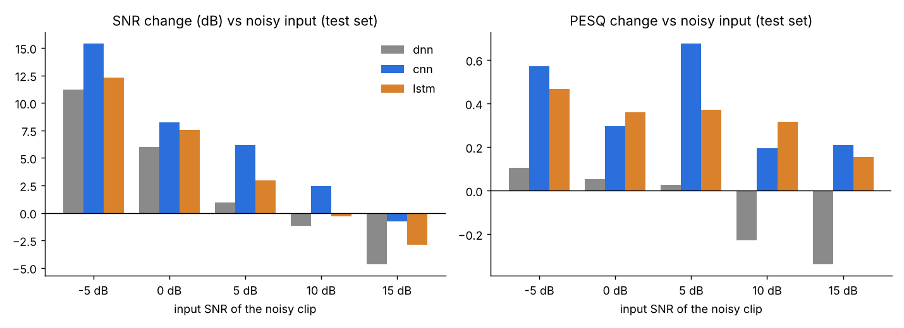

# Model comparison results: DNN vs CNN vs LSTM

**Setup** (per the CA, 10/13): all three models were trained on all 500 training clips with an identical recipe (`src/compare/config.py`: Adam at LR 1e-3, batch size 8, up to 60 epochs with early stopping, the same loss and the same input/output). The winner was chosen on the **validation** set (SNR must improve, then highest PESQ). The **test** set (6 unseen speakers, unseen noise files) is the final check. Code and how to rerun are in `src/compare/README.md`.

## Headline (test set, noisy → denoised)

| model | params | SNR (dB) | clips with worse SNR | PESQ | STOI |
|---|---|---|---|---|---|
| DNN | 1.14M | 4.66 → 7.12 (**+2.5**) | 34% | 1.67 → 1.59 (**−0.08**) | 0.744 → 0.608 |
| **CNN (U-Net)** ✅ | 0.30M | 4.66 → 10.96 (**+6.3**) | 14% | 1.67 → 2.06 (**+0.39**) | 0.744 → 0.735 |
| LSTM | 1.12M | 4.66 → 8.59 (**+3.9**) | 34% | 1.67 → 2.00 (**+0.33**) | 0.744 → 0.722 |

The CNN won on validation (SNR +8.4 dB, PESQ 1.63 → 2.38) and also came out best on test, with the smallest model of the three. Full tables by noise type and SNR level are in `comparison.md`.

## What we learned

1. **CNN > LSTM > DNN.** Treating the spectrogram as an image (the CNN) beat reading it frame by frame (the LSTM), and both beat the no-context DNN. The CNN improved SNR and PESQ for **every** noise type.
2. **The CA's "SNR can't get worse" rule.** The noisiest clips (−5 dB) gain the most: +15 dB for the CNN. On the cleanest clips (15 dB input) every model still removes a little too much: the CNN loses 0.8 dB, the LSTM 2.9 dB and the DNN 4.7 dB. That is over-suppression: the mask mutes bits of real speech along with the noise. The first tuning run (below) targets this with a mask floor.
3. **The DNN overfits to the validation speakers.** It looked fine on validation (+6.3 dB, PESQ +0.45) but fell apart on test speakers, with lower PESQ and much lower STOI. With only 6 speakers each in val and test, a single hard speaker (test speaker 1004) can swing the averages. Treat differences of a few hundredths of PESQ as noise.
4. **STOI stayed about flat for the CNN** (0.744 → 0.735) and the LSTM. That is much better than the 100-clip LSTM prototype (0.744 → 0.692), so more data fixed most of the intelligibility drop.
5. **Cost.** The CNN took about 3.5 h to train on a 2-core CPU, against about 9 min each for the DNN and LSTM. On a Colab GPU it should take minutes. The LSTM is still the natural pick if we go for the real-time streaming stretch goal, because it never looks ahead.

## Files

- `comparison.md` / `comparison.csv` / `*.png`: the side-by-side table and charts (`python src/compare/compare.py`)
- `<model>/config.json`: every setting used, parameter count, best epoch and training time
- `<model>/history.csv`: training and validation loss per epoch
- `<model>/{val,test}_summary.json`: averages overall, by noise type and by input SNR level
- `<model>/{val,test}_per_clip.csv`: scores for every clip
- `<model>/denoised_wavs/`: the first 5 test clips after denoising. Compare them with `data/processed/test/noisy` and `/clean`.

## Next (tuning the CNN, one setting at a time)

- `cnn_floor0.1`: mask floor 0.1 (never mute a bin by more than 20 dB), aimed at the over-suppression on clean clips
- Then batch size (8 → 16) and LR, as the CA suggested, preferably on a Colab GPU
