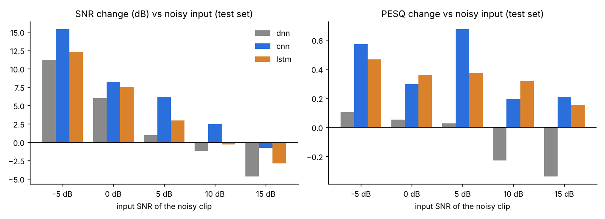
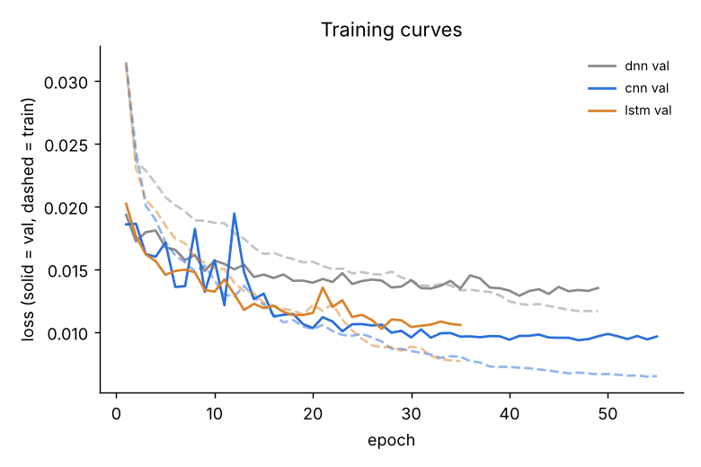

# DNN vs CNN vs LSTM - all 500 training clips

All runs: same 500 training clips, same 50 val / 50 test clips, same recipe (`src/compare/config.py`). Winner = SNR must improve on val, then highest val PESQ. Test numbers are the final, untouched check.

| run | params | best epoch | train min | test SNR in→out (dB) | ΔSNR | clips worse | test PESQ in→out | ΔPESQ | test STOI in→out | picked |
|---|---|---|---|---|---|---|---|---|---|---|
| dnn | 1,136,897 | 41 | 9.2 | 4.66 → 7.12 | +2.46 | 34% | 1.666 → 1.589 | -0.077 | 0.744 → 0.608 |  |
| cnn | 303,713 | 47 | 207.9 | 4.66 → 10.96 | +6.3 | 14% | 1.666 → 2.055 | +0.389 | 0.744 → 0.735 | ✅ |
| lstm | 1,119,745 | 27 | 9.3 | 4.66 → 8.59 | +3.93 | 34% | 1.666 → 1.999 | +0.334 | 0.744 → 0.722 |  |

## Test set by input SNR level (ΔSNR dB / ΔPESQ)

| run | -5 dB | 0 dB | 5 dB | 10 dB | 15 dB |
|---|---|---|---|---|---|
| dnn | +11.20 / +0.10 | +6.02 / +0.05 | +0.94 / +0.03 | -1.18 / -0.23 | -4.70 / -0.34 |
| cnn | +15.41 / +0.57 | +8.25 / +0.30 | +6.18 / +0.68 | +2.43 / +0.19 | -0.78 / +0.21 |
| lstm | +12.32 / +0.47 | +7.54 / +0.36 | +2.97 / +0.37 | -0.30 / +0.32 | -2.88 / +0.16 |

## Test set by noise type (ΔSNR dB / ΔPESQ)

| run | door | fan | munching | squeak | typing |
|---|---|---|---|---|---|
| dnn | +2.77 / -0.13 | +2.31 / -0.04 | +4.62 / -0.14 | +1.41 / -0.23 | +1.17 / +0.16 |
| cnn | +9.13 / +0.55 | +4.67 / +0.28 | +7.61 / +0.34 | +5.79 / +0.20 | +4.29 / +0.57 |
| lstm | +4.37 / +0.21 | +2.78 / +0.21 | +6.19 / +0.43 | +2.60 / +0.24 | +3.72 / +0.58 |

