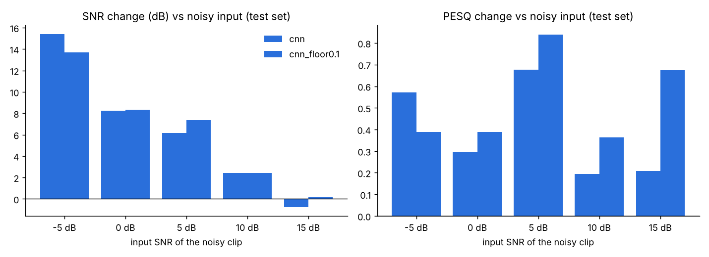
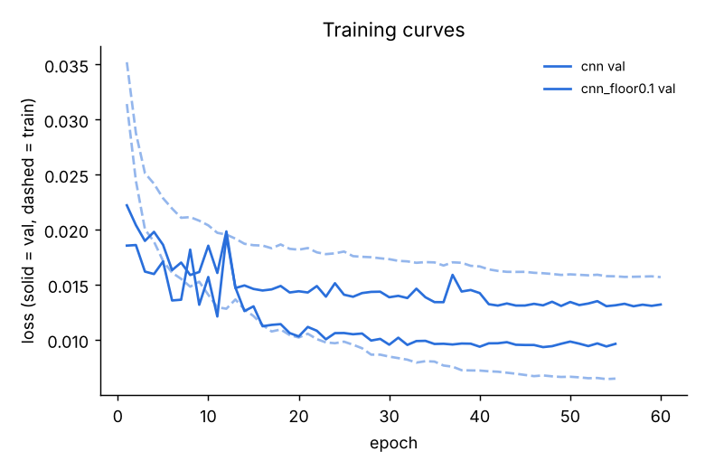

# CNN tuning: mask floor 0 vs 0.1

All runs: same 500 training clips, same 50 val / 50 test clips, same recipe (`src/compare/config.py`). Winner = SNR must improve on val, then highest val PESQ. Test numbers are the final, untouched check.

| run | params | best epoch | train min | test SNR in→out (dB) | ΔSNR | clips worse | test PESQ in→out | ΔPESQ | test STOI in→out | picked |
|---|---|---|---|---|---|---|---|---|---|---|
| cnn | 303,713 | 47 | 207.9 | 4.66 → 10.96 | +6.3 | 14% | 1.666 → 2.055 | +0.389 | 0.744 → 0.735 | ✅ |
| cnn_floor0.1 | 303,713 | 57 | 224.0 | 4.66 → 11.06 | +6.39 | 18% | 1.666 → 2.196 | +0.531 | 0.744 → 0.751 |  |

## Test set by input SNR level (ΔSNR dB / ΔPESQ)

| run | -5 dB | 0 dB | 5 dB | 10 dB | 15 dB |
|---|---|---|---|---|---|
| cnn | +15.41 / +0.57 | +8.25 / +0.30 | +6.18 / +0.68 | +2.43 / +0.19 | -0.78 / +0.21 |
| cnn_floor0.1 | +13.69 / +0.39 | +8.33 / +0.39 | +7.35 / +0.84 | +2.44 / +0.36 | +0.17 / +0.67 |

## Test set by noise type (ΔSNR dB / ΔPESQ)

| run | door | fan | munching | squeak | typing |
|---|---|---|---|---|---|
| cnn | +9.13 / +0.55 | +4.67 / +0.28 | +7.61 / +0.34 | +5.79 / +0.20 | +4.29 / +0.57 |
| cnn_floor0.1 | +8.26 / +0.69 | +4.71 / +0.46 | +8.67 / +0.57 | +6.04 / +0.37 | +4.30 / +0.57 |

